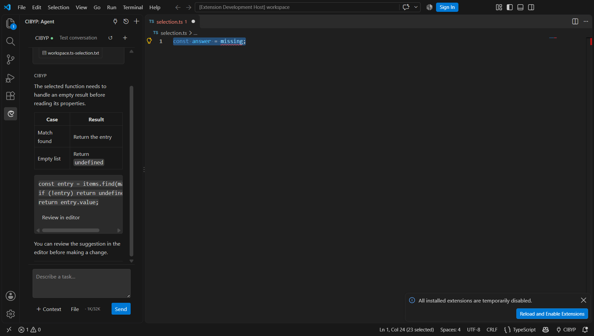

# Could I Be Your Partner · IDE

[](https://github.com/B5-Software/CIBYP-IDE/actions/workflows/build.yml)
[](https://github.com/B5-Software/CIBYP-IDE/releases)
[](LICENSE)

VS Code 与 JetBrains 原生集成，连接 [CIBYP](https://github.com/B5-Software/Could-I-Be-Your-Partner) 的共享后台。GUI、TUI、WebUI、IDE 共用会话、模型、工具、权限与 VM；插件不包含或另起 LLM 运行时。

|          | VS Code                                      | JetBrains                                       |
| -------- | -------------------------------------------- | ----------------------------------------------- |
| 界面     | 主题化聊天侧栏、原生命令与快速选择器         | Swing Tool Window、原生工具栏、对话框与差异窗口 |
| 最低版本 | 1.96                                         | IntelliJ Platform 2025.2（252）                 |
| 凭据     | VS Code SecretStorage                        | IDE PasswordSafe                                |
| 连接     | 本机实例发现、远程 HTTPS、SSH 本地端口转发   | 同左                                            |
| 对话     | 共享会话与历史、热消息、停止、审批、问卷     | 同左                                            |
| 编辑器   | 未保存选区 / 文件 + 语言诊断，作为可移除附件 | 未保存选区 / 文件，作为可移除附件               |
| 代码建议 | 原生只读 Diff，用户手动决定修改              | 原生只读 Diff，用户手动决定修改                 |
| 主题     | IDE 深浅色、高对比度、字体和焦点颜色         | IDE Look and Feel、缩放、字体与焦点颜色         |
| 语言     | 简体中文 / 英文                              | 简体中文 / 英文                                 |

## 安装与连接

1. 从 Releases 下载 `.vsix` 或 JetBrains `.zip`。
2. VS Code：Extensions → **Install from VSIX…**；JetBrains：Settings → Plugins → ⚙ → **Install Plugin from Disk…**。
3. 先运行 `cibyp`、`cibyp-tui` 或 `cibyp-webui`，打开 CIBYP 工具窗口，选择 **连接实例**。
4. 本机实例从当前用户的临时发现文件读取，验证协议、进程、回环地址及后台 PID；不要求 WebUI 开放端口或额外密码。
5. 远程实例使用 CIBYP 的 WebUI 地址、密码与可选二次验证码。会话令牌进入 IDE 凭据库，密码不保存。

VS Code 的 **CIBYP: Start Local Backend** 会在可见集成终端启动 `cibyp-tui`；插件不会悄悄下载安装软件。JetBrains 可先在 IDE Terminal 运行上述命令。

新建 Code 会话会把当前本机项目交给后台 `setWorkspace`，沿用 CIBYP 的主机 / VM 导入与双向同步。远程连接会明确询问**服务器上的路径**，不会把本机目录误当作远程路径。远程项目文件不会自动上传整棵目录；显式附件可上传，单个最多 8 MiB，每条最多 10 个。

本机自动发现发生在**扩展运行的机器**上：VS Code Remote SSH / WSL / Dev Container 使用远端扩展宿主；JetBrains Remote Development 使用后端项目进程。若 CIBYP 在另一台机器运行，请使用远程连接或端口转发。

```sh
# 用本机 SSH 隧道访问只监听回环地址的远程 WebUI
ssh -N -L 3456:127.0.0.1:3456 user@your-machine
# 插件连接 http://127.0.0.1:3456，使用远程 WebUI 密码登录
```

远程直连要求 HTTPS，不自动降级为明文；`.onion` 原生 Tor 传输尚未接入 IDE 插件，可由用户自行建立本地受信任隧道。IDE 断开连接或关闭窗口不会停止后台任务，**停止**按钮才停止当前会话。审批仅允许本次或拒绝；过期审批先核对后台当前请求，避免替另一条请求作答。

## 界面预览

VS Code 截图来自真实扩展宿主，使用隔离项目与确定性的测试对话；界面直接使用当前 IDE 的颜色、字体和焦点样式。



[浅色主题截图](docs/screenshots/vscode-light.png)。[JetBrains 原生组件预览](docs/screenshots/jetbrains-native.png)由 IntelliJ 平台测试框架渲染生产 Tool Window 组件，包含 Markdown 表格、附件、原生差异入口与输入区；它不是完整 IDE 窗口截图。

## 开发与验证

```sh
npm ci --ignore-scripts
npm run build
npm test
npm run test:vscode
npm run package:vscode
cd jetbrains
./gradlew test buildPlugin
```

`npm run test:vscode` 启动真实 VS Code 扩展宿主，用隔离项目和确定性的后台替身验证连接、工作区、未保存选区与诊断附件、Webview 发送、新对话与停止，不调用付费模型。设置 `CIBYP_VSCODE_EXECUTABLE` 可复用已安装 VS Code。设置 `CIBYP_SOURCE` 指向桌面仓库可额外运行真实 BackendServer 的 HTTP / WebSocket 合约测试。客户端测试覆盖丢失回执后的请求去重、事件回放过期与登录过期。

CI 分别生成 VSIX 和 JetBrains 插件 ZIP，检查真实 VS Code 扩展宿主和桌面协议；标签 `v*` 在全部任务通过后生成带 SHA-256 的 GitHub Prerelease。目前不自动发布 Marketplace；Marketplace 发布需要各平台发行账号，下载包可以直接安装。

## 验证范围

这是首个可安装版本，不宣称已经验证所有 IDE / 远程开发组合。JetBrains 语言诊断与 LSP 的通用回传、IDE 原生 Tor、交互式多文件补丁合并是后续工作。Agent 文件与终端操作继续遵循 CIBYP 后台审批；“在编辑器审查”不会自动执行代码或覆盖文件。Markdown 中的 HTML 和远程图片不加载。

接口说明：[protocol.md](docs/protocol.md)。前端遵循 [VS Code Webview UX](https://code.visualstudio.com/api/ux-guidelines/webviews) 和 [JetBrains Tool Windows](https://plugins.jetbrains.com/docs/intellij/tool-windows.html)。

## 硬件节点

VS Code 的 `CIBYP: Hardware Nodes` 命令 / 标题栏电路板按钮、JetBrains 工具窗口的硬件按钮查看当前后台的设备与授权资源。目录分页，策略按需读取；显示使用 IDE 原生选择器与只读预览。硬件动作交给聊天 Agent，保留审批和租约。新版后台的审批回答携带 interaction ID / revision，旧后台继续兼容。硬件入口需要 Remote v2（当前桌面源码或 CIBYP Mini）。
